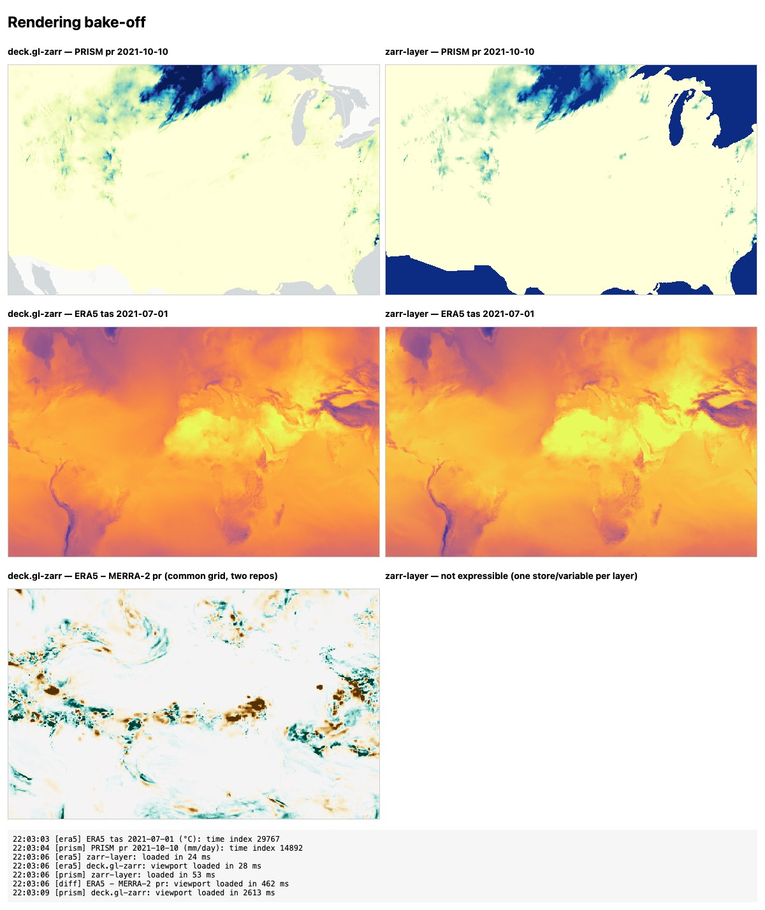

# Comparison website: stack and rendering bake-off

## Stack

- **Build and UI:** Vite 8 and Svelte 5 (TypeScript). The site is static; in development, the Vite dev server also
  serves the local Icechunk mirrors.
- **Map:** MapLibre GL 5 with deck.gl 9.4 through `@deck.gl/mapbox` `MapboxOverlay` (interleaved). Data
  layers use `@developmentseed/deck.gl-zarr` 0.9 and deck.gl-raster GPU modules: `CreateTexture`,
  `FilterNoDataVal`, `LinearRescale` and `Colormap`.
  - Basemap: OpenStreetMap raster tiles (`tile.openstreetmap.org`). That is fine for local use; a public site
    should switch to a tile provider that allows it (OSM tile usage policy).
  - The data layer sits below toggleable coastline, national-border and US-state lines (MapLibre line layers
    from Natural Earth 1:10m, `scripts/web/make_overlays.py` → `site/public/overlays/`). Its opacity comes from
    the transparency slider.
- **Time series:** Apache ECharts 6 (tree-shaken: line chart, tooltip, data zoom, toolbox), in
  `src/lib/SeriesChart.svelte`. Chosen over uPlot (no built-in pan) and Plotly (several MB) because zoom, pan,
  range slider and a multi-series hover tooltip are built in.
- **Data:**
  - `zarrita` 0.7.5 reads Zarr v2 and v3, including sharding.
  - `icechunk-js` 0.6.1 reads Icechunk v1 and v2 over HTTPS. It is pure TypeScript and needs no COOP/COEP headers.
  - `@climate-mirror/pco-wasm` (in this repo) decodes `numcodecs.pcodec` chunks. Our mirrors and Earthmover's
    ERA5 both use pcodec.
  - A small `fixedscaleoffset` codec handles NASA POWER's Zarr stores.
  - CF `scale_factor`, `add_offset` and `_FillValue` are applied in `getTileData`.
- **Configuration:** `site/src/generated/sources.json` is generated from `stores.toml` by
  `scripts/web/write_sources.py`. Moving a mirror to S3-compatible storage only changes that file.

## Bake-off (2026-11-02)

The same local Icechunk data was drawn with deck.gl-zarr 0.9.0 and `@carbonplan/zarr-layer` 0.11.0 (`site/bakeoff.html`).
The capture uses headless Chrome via `site/scripts/snapshot.mjs`; the desktop preview pane does not capture WebGL canvases.

| | deck.gl-zarr | zarr-layer |
|---|---|---|
| ERA5 `tas`, global float32 pcodec | correct | correct, identical |
| PRISM `pr`, CF-packed uint32 pcodec, NAD83 | correct; nodata transparent | **sentinel `_FillValue` rendered as data**: oceans and Great Lakes come out solid blue |
| A − B across two repos (ERA5 − MERRA-2, common grid) | yes (`getTileData` reads both arrays) | not expressible; one store and variable per layer |
| Same stack as `multi-resolution-new-haven` | yes (deck.gl 9.4 + deck.gl-raster) | no (MapLibre custom layer) |
| Globe | not yet (Web Mercator) | yes |
| Code needed | more (tile upload and render pipeline) | less |

**Choice: deck.gl-zarr.**
- It is correct with our CF-packed data.
- It supports cross-dataset differences.
- It shares tooling with the other project.

**Notes:**
- deck.gl-zarr 0.9's `variable` prop names a *multiscale group*. Pass single-level arrays as `node`, and the group's
  GeoZarr attributes as `metadata`.
- Global grids whose edge rows extend past ±90° make the reprojection mesh warn (it does not converge). The map
  still renders correctly in Web Mercator.
- A full PRISM daily map took about 2.6 s locally while each 256×256 tile decoded a whole 32-day chunk. PRISM daily
  now stores one-day chunks inside 32-day shards: a CONUS map is about 1.2 s and 7 MB (see reports/prism.md).
  Decoding still runs on the main thread; a worker would help.
